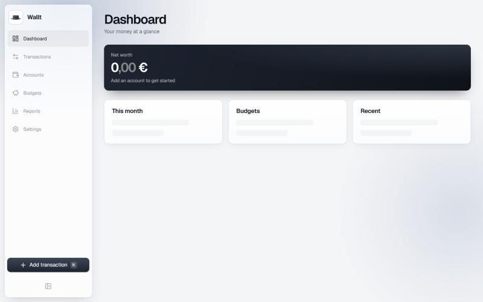
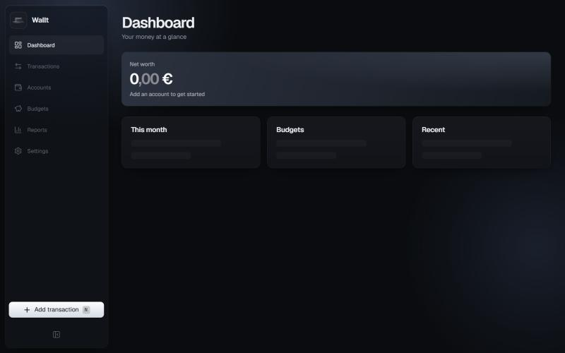
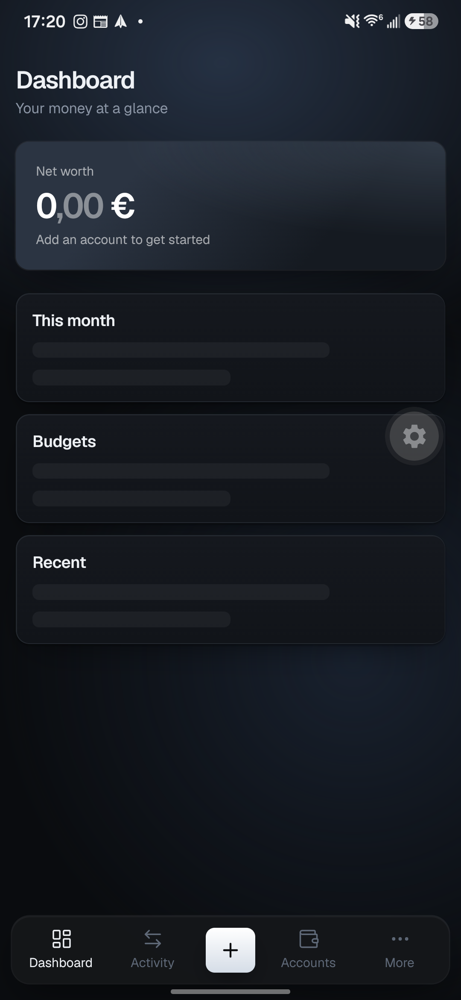
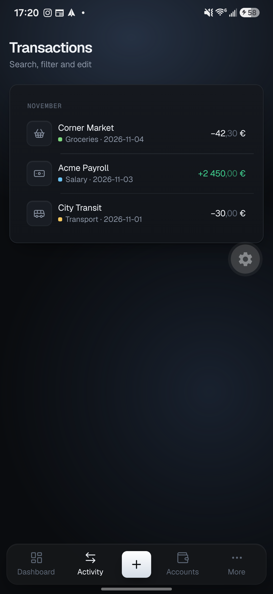
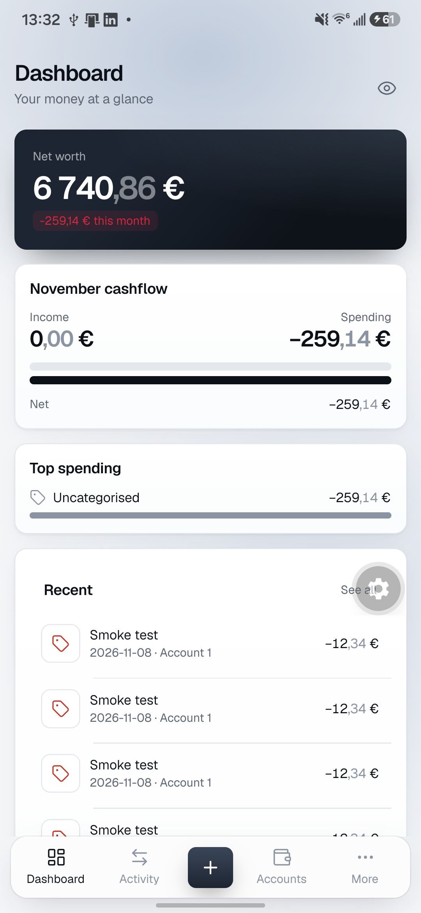
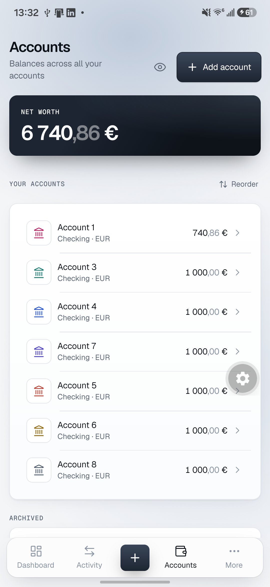

# Wallt

**Self-hosted personal finance & budget tracker** — multiple accounts, transactions, budgets, categories, reports and
universal statement import. Your data lives on your own server; there are no bank connections and no third-party
analytics.

[](https://github.com/fmgoliveira/wallt/actions/workflows/ci.yml)
[](LICENSE)

<p align="center">
  
  
</p>
<p align="center">
  
  
  
  
</p>

## Features

- **One codebase, two clients:** an Expo (React Native) app for Android and a responsive web app with the same design
  (light and dark themes).
- **Offline-first:** the Android app works from a local SQLite database and syncs with your server.
- **Accounts, transactions, budgets, categories and reports**, with optional receipt attachments.
- **Universal import:** bring in CSV/statement exports from your bank; layouts are auto-detected.
- **Smart categorization:** rules plus a local model that runs on your server; anything uncertain goes to a review queue.
- **Secure by default:** mandatory TOTP two-factor authentication, rate limiting and lockout, hardened container.
- **Encrypted backups** to Google Drive (optional), plus export / restore / erase of your data.
- **Self-hosted:** a single Docker container with a SQLite file database and one data volume.

## Quick start (self-hosting)

You need Docker and a host that can terminate TLS (for example nginx). `docker compose up` pulls the prebuilt image
`ghcr.io/fmgoliveira/wallt` (pin a version with `WALLT_VERSION` in `.env`). To build from source instead, add
`-f docker-compose.build.yml` and `--build`.

```bash
git clone https://github.com/fmgoliveira/wallt.git && cd wallt
cp .env.example .env     # set ENCRYPTION_KEY (openssl rand -base64 32) and SETUP_TOKEN
docker compose up -d
curl -fsS http://127.0.0.1:3000/health
```

Then create your account, set up 2FA, and put the server behind HTTPS. The full guide (nginx config, first account,
backups to Google Drive, upgrades) is in [`docs/deploy.md`](docs/deploy.md).

**Android:** download the signed APK from the [latest release](https://github.com/fmgoliveira/wallt/releases/latest)
and sign in to your server. **Web:** open your server's URL.

## Project layout

```
apps/
  app/      Expo app (Android + web)
  server/   API, sync, scheduler, serves the web export
  e2e/      Playwright (web) and Maestro (Android) tests
packages/
  core/ db/ sync/ ingest/ categorize/ ui/ config/
docs/       plan, architecture decision records (ADRs), deployment and release guides
```

The design and the reasoning behind it: [`docs/PLAN.md`](docs/PLAN.md) and [`docs/adr/`](docs/adr/).

## Development

Requires Node 26 (see `.nvmrc`) and pnpm (`corepack enable` picks up the pinned version).

```bash
pnpm install
pnpm lint        # Biome
pnpm typecheck   # tsc via Turborepo
pnpm test        # Vitest via Turborepo
pnpm build
pnpm format      # Biome auto-fix
```

Copy `.env.example` to `.env` for local settings. Shared TS/Biome config lives in `packages/config`.

### End-to-end tests
- **Web (Playwright, runs in CI):** `pnpm --filter @wallt/app build`, then `pnpm e2e` (first time:
  `pnpm --filter @wallt/e2e exec playwright install chromium`). The tests start the server serving the web export on
  port 3100 with a throw-away data directory; see `apps/e2e`.
- **Android (Maestro, by hand):** install the app on an emulator or device, then
  `maestro test apps/e2e/maestro/smoke.yaml`.

## Contributing

Contributions are welcome — please read [CONTRIBUTING.md](CONTRIBUTING.md) and the [Code of Conduct](CODE_OF_CONDUCT.md)
first. **In case of doubt, ask first:** open an issue before writing code for anything non-trivial. Contributor and
agent rules are in [`AGENTS.md`](AGENTS.md).

## Releases

Tagged releases publish the server image to GHCR and a signed APK to the GitHub Release, driven by release-please. See
[`docs/release.md`](docs/release.md). If you fork the project and want your own APKs, you need your own signing key and
secrets (also described there).

## Security

Please report vulnerabilities privately, see [SECURITY.md](SECURITY.md).

## License

[GNU AGPL-3.0](LICENSE). If you run a modified version as a network service, you must make your changes available to
its users under the same license.
